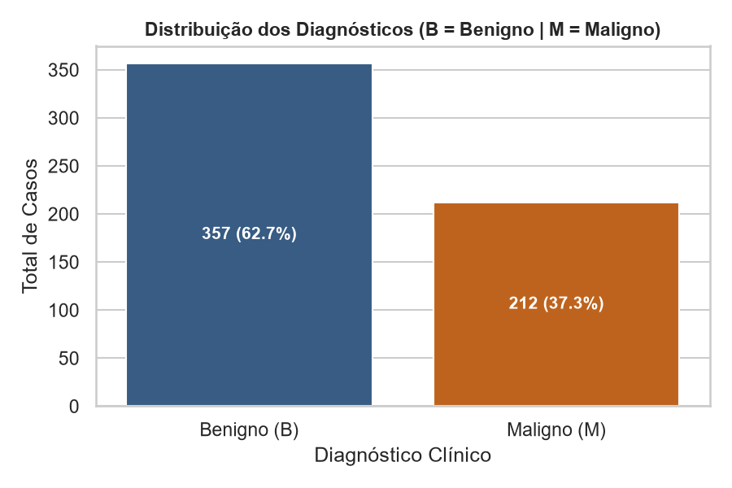
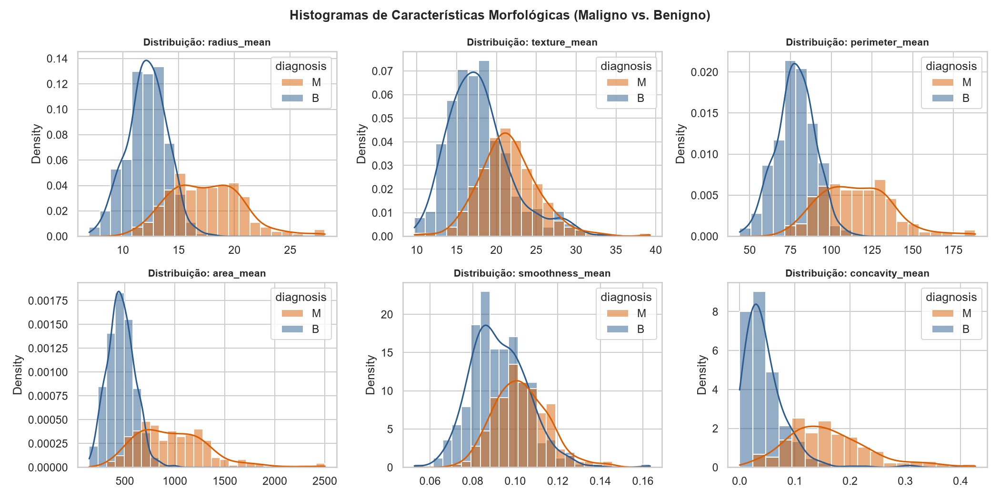
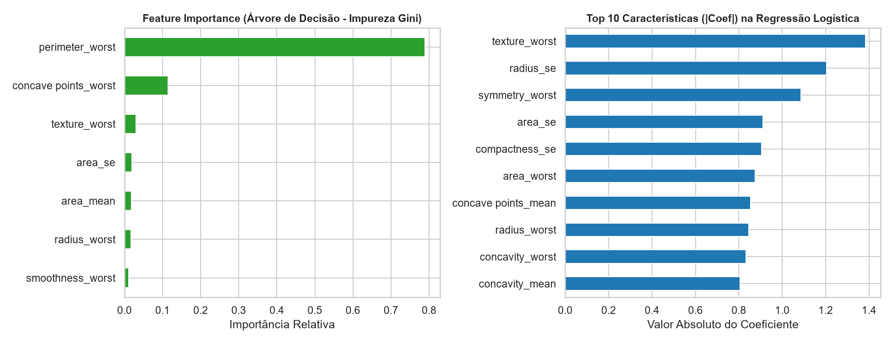
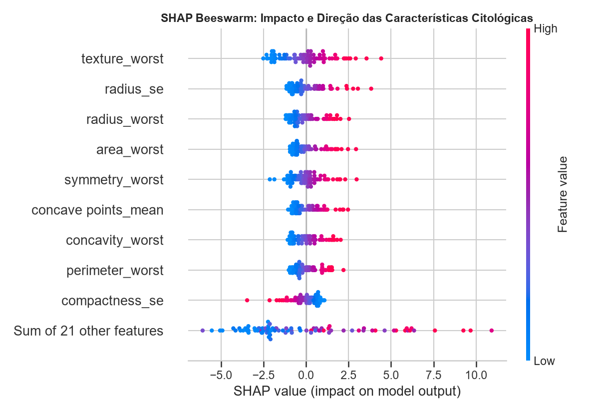
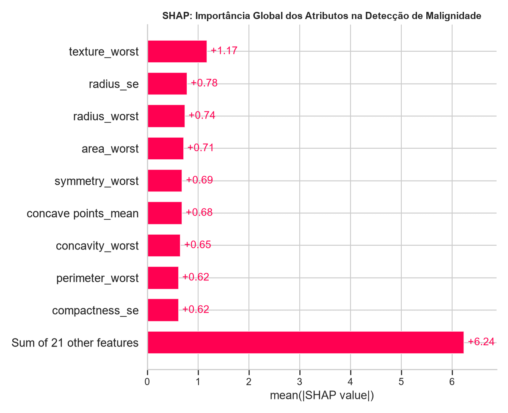
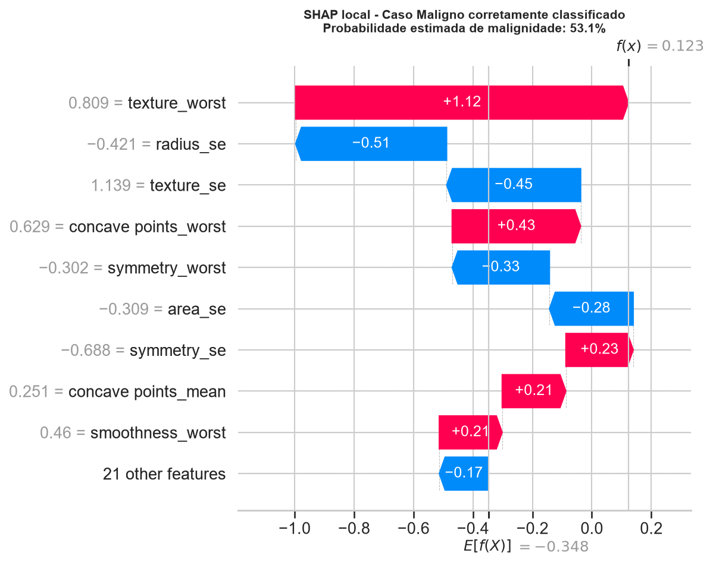
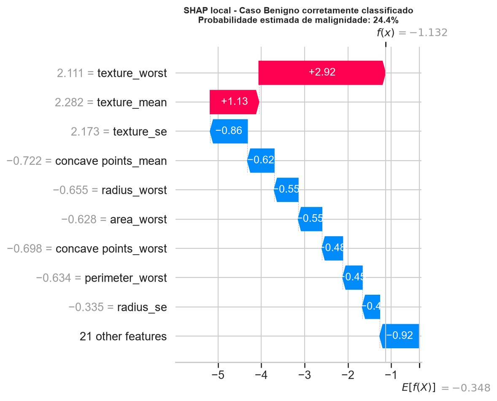
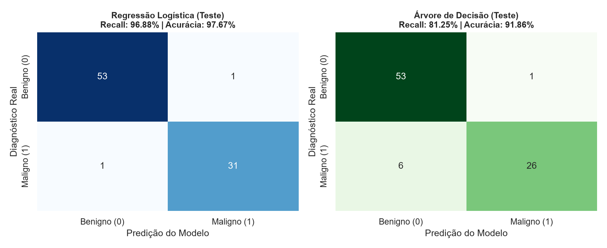

# 📺 SCRIPT TELEPROMPTER - TECH CHALLENGE FASE 1
## Diagnóstico de Câncer de Mama com IA
**⏱️ LEITURA: ~10 MINUTOS**

> 💡 **COMO USAR:** Leia cada bloco em voz alta. Quando ver [MOSTRAR DO NOTEBOOK], clique na célula correspondente para exibir no notebook. Fale com naturalidade, não roboticamente.

---

## 🎬 ABERTURA (30 seg)

---

Oi, tudo bem? Meu nome é Bruno Miranda, e hoje vou compartilhar uma solução de inteligência artificial que desenvolvemos para um hospital.

[PAUSA 2 seg]

O desafio: hospitais têm cada vez mais pacientes, mais exames de mamografia para detectar câncer de mama. Médicos Patologistas ficam sobrecarregados, as filas crescem... e quanto maior a espera, pior o prognóstico do paciente se for descoberto um câncer.

[PAUSA 2 seg]

Nossa solução? Uma IA que funciona como um **analista clínico automatizado**. Ela analisa os resultados dos exames e **prioriza os casos suspeitos** para que o médico veja primeiro.

[PAUSA 2 seg]

Deixo bem claro: a IA **não substitui o patologista**. A responsabilidade final pelo diagnóstico é sempre do médico. A IA é uma **ferramenta de apoio** para ganhar velocidade e segurança.

[PAUSA 3 seg]

---

## 📊 BLOCO 1: OS DADOS (1 min)

---

Vamos começar pelos dados que usamos para treinar essa IA.

[PAUSA 2 seg]

[MOSTRAR DO NOTEBOOK: Célula de Distribuição do Alvo - gráfico com histograma 63% benigno, 37% maligno]

Aqui temos uma base de 569 amostras de exames de mama. Você vê:
- **63% foram diagnosticados como benignos** — a maioria é segura
- **37% foram diagnosticados como malignos** — esses são os casos críticos que precisamos detectar

[PAUSA 2 seg]

Cada uma dessas 569 amostras está organizada em **32 colunas**. Dessas, **30 são medidas numéricas** das características do núcleo celular; as outras duas indicam o identificador da amostra e o diagnóstico. Entre as medidas, temos:
- **Raio do núcleo** — uma medida do tamanho do núcleo
- **Área** — quanto espaço ocupa
- **Concavidade** — o quanto o contorno apresenta reentrâncias
- **Textura** — a variação dos tons de cinza na imagem do núcleo

[PAUSA 2 seg]

[MOSTRAR DO NOTEBOOK: Célula de Distribuições Morfológicas - 6 histogramas em duas linhas, comparando características dos núcleos]

Agora observe este gráfico muito importante.

[PAUSA 2 seg]

Cada painel compara a distribuição de uma característica: **azul representa amostras benignas e laranja, malignas**. A ordem é da esquerda para a direita, primeiro na linha de cima e depois na de baixo:

Na linha de cima estão **raio médio** (*radius_mean*), **textura média** (*texture_mean*) e **perímetro médio** (*perimeter_mean*). Na linha de baixo estão **área média** (*area_mean*), **suavidade média** (*smoothness_mean*) e **concavidade média** (*concavity_mean*).

O **raio** mede o tamanho do núcleo; a **textura** indica a variação dos tons de cinza; e a **concavidade** mede as reentrâncias do contorno. Em vários painéis, as distribuições laranja aparecem deslocadas para valores maiores, mas há sobreposição entre os grupos.

Isso significa que essas medidas ajudam o modelo a diferenciar os grupos quando consideradas em conjunto. Nenhum painel, sozinho, determina um diagnóstico.

[PAUSA 3 seg]

**Ponto-chave:** O modelo combina várias características morfológicas para estimar a classe. As distribuições mostram tendências nos dados, não uma regra isolada para diagnosticar um paciente.

[PAUSA 2 seg]

---

## 🤖 BLOCO 2: PREPARAÇÃO E TREINO DO MODELO (2 min)

---

Antes de treinar qualquer IA, precisamos separar os dados.

[PAUSA 2 seg]

[MOSTRAR DO NOTEBOOK: saída da célula de divisão dos dados, com 398 amostras para treino, 85 para validação e 86 para teste]

| Conjunto | Percentual | Amostras |
|---|---:|---:|
| Treino | 70% | 398 |
| Validação | 15% | 85 |
| Teste | 15% | 86 |

Fizemos assim:
- **70% dos dados (398 amostras) → Treino**: o modelo aprende os padrões aqui
- **15% dos dados (85 amostras) → Validação**: usamos para ajustar configurações
- **15% dos dados (86 amostras) → Teste**: guardamos secreto para avaliação final, como um exame surpresa

[PAUSA 2 seg]

Por que essa separação? Porque se você treinar e testar com os mesmos dados, o modelo "decora" a resposta e mente sobre o desempenho real. Separar garante que o teste é **honesto e realista**.

[PAUSA 2 seg]

Treinamos **dois modelos diferentes**:

[MOSTRAR DO NOTEBOOK: tabela "COMPARATIVO DE MÉTRICAS (CONJUNTO DE TESTE)"; não confundir com a tabela anterior, que é do conjunto de validação]

| Modelo | Acurácia | Precisão | Recall (Sensibilidade) | F1-Score | ROC-AUC |
|---|---:|---:|---:|---:|---:|
| Regressão Logística | 0,9767 | 0,9688 | 0,9688 | 0,9688 | 0,9988 |
| Árvore de Decisão | 0,9186 | 0,9630 | 0,8125 | 0,8814 | 0,9413 |

Os valores da tabela estão em escala de 0 a 1. Em porcentagem, a acurácia da Regressão Logística é 97,67%, por exemplo. Enquanto a tabela estiver na tela, compare acurácia, recall e precisão dos dois modelos. Na fala, podemos arredondar os valores:

**Primeiro: Regressão Logística**
- Acurácia: aproximadamente 98%
- Recall (Sensibilidade): aproximadamente 97% para malignos
- Precisão: aproximadamente 97% (quando prevê maligno, acerta cerca de 97% das vezes)

**Segundo: Árvore de Decisão**
- Acurácia: aproximadamente 92%
- Recall para malignos: aproximadamente 81%
- Precisão: aproximadamente 96% (quando prevê maligno, acerta cerca de 96% das vezes)

[PAUSA 2 seg]

O que isso significa?

A **Regressão Logística acertou cerca de 98%** dos 86 casos de teste — 84 acertos e 2 erros no total. Entre os 32 casos malignos, deixou passar 1.

A **Árvore de Decisão** acertou cerca de 92% dos casos e identificou aproximadamente 81% dos malignos; entre os 32 casos malignos, deixou passar 6.

[PAUSA 2 seg]

Para produção hospitalar, escolhemos a **Regressão Logística** porque:
1. Tem a melhor acurácia geral: 98%
2. Detecta 97% dos cânceres — confiável para o cenário médico
3. Tem precisão de aproximadamente 97%: entre as amostras sinalizadas como malignas, cerca de 97% eram malignas
4. É mais equilibrada e interpretável

[PAUSA 2 seg]

**Número crítico:** No conjunto de teste, a Regressão Logística deixou passar **1 dos 32 casos malignos**, equivalente a 96,88% de sensibilidade. Esse resultado é promissor, mas o modelo é uma ferramenta de apoio e não substitui a avaliação médica.

[PAUSA 3 seg]

---

## 🔍 BLOCO 3: POR QUE A IA DECIDIU ASSIM? EXPLICABILIDADE COM SHAP (4:30 min)

---

Aqui vem a parte **mais importante** do projeto.

[PAUSA 2 seg]

Um problema comum com inteligência artificial é: "Como eu sei em que o modelo se baseou?". Um médico não vai confiar num algoritmo que dá uma resposta mas não explica o porquê.

[PAUSA 2 seg]

É por isso que usamos **SHAP** — uma técnica que decompõe a decisão do modelo. Mostra exatamente quais características "votaram" para "maligno" e quais "votaram" para "benigno".

[PAUSA 2 seg]

---

### **3.1 - QUAIS SÃO AS FEATURES MAIS IMPORTANTES?**

[MOSTRAR DO NOTEBOOK: Célula de Feature Importance - os dois gráficos lado a lado: importância da Árvore de Decisão e coeficientes da Regressão Logística]

Esta figura compara os rankings de características dos dois modelos. À esquerda está a importância da Árvore de Decisão, calculada pela Impureza Gini. À direita estão os valores absolutos dos coeficientes da Regressão Logística.

[PAUSA 2 seg]

No gráfico da Árvore de Decisão, destaque:

**1. `perimeter_worst`** — maior perímetro observado do núcleo; é a característica de maior importância nesse modelo.

**2. `concave points_worst`** — maior número de pontos côncavos no contorno.

**3. `texture_worst`** — medida de textura do núcleo.

No gráfico da Regressão Logística, as maiores magnitudes são `texture_worst`, `radius_se` e `symmetry_worst`. Como o gráfico mostra valores absolutos, ele indica a magnitude dos coeficientes, mas não se cada característica empurra a previsão para benigno ou maligno.

[PAUSA 2 seg]

**Insight importante:** Os modelos podem priorizar características diferentes. Esses gráficos mostram a importância ou magnitude no modelo; o sentido da contribuição para cada previsão será explicado com o SHAP nos próximos gráficos.

[PAUSA 3 seg]

---

### **3.2 - O GRÁFICO BEESWARM: VISÃO GLOBAL**

[MOSTRAR DO NOTEBOOK: Célula SHAP Beeswarm Plot - gráfico mostrando padrão de explicações]

Este é o gráfico SHAP mais importante. Deixa eu explicar:

[PAUSA 2 seg]

**Eixo horizontal:** o quanto cada característica contribui para a decisão "maligno"
- Esquerda = empurra para "benigno"
- Direita = empurra para "maligno"

**Cores:** azul significa valor baixo da feature, vermelho significa valor alto

**Cada ponto:** um paciente diferente

[PAUSA 2 seg]

Observe a ordem das linhas: **`texture_worst` aparece em primeiro**, seguida por **`radius_se`**, `radius_worst`, `area_worst` e `symmetry_worst`. As cores indicam o valor da característica, e a posição horizontal mostra a direção e a magnitude da contribuição para a saída da Regressão Logística.

[PAUSA 2 seg]

Para `texture_worst`, valores altos aparecem frequentemente com contribuições positivas para a classe maligna; valores baixos tendem a ficar mais próximos ou à esquerda de zero. Há variação entre as amostras, então isso descreve tendências aprendidas pelo modelo, não uma regra diagnóstica nem uma relação causal.

[PAUSA 2 seg]

**Ponto-chave:** O SHAP ajuda a inspecionar como as características influenciam as previsões do modelo no conjunto de teste. A interpretação continua dependendo da avaliação clínica.

[PAUSA 3 seg]

---

### **3.3 - SHAP BAR PLOT: IMPORTÂNCIA GLOBAL**

[PAUSA 2 seg]

Agora vou mostrar o resumo da magnitude média das contribuições SHAP da Regressão Logística no conjunto de teste.

[PAUSA 2 seg]

[MOSTRAR DO NOTEBOOK: Célula SHAP Bar Plot - importância global da Regressão Logística]

Neste gráfico, `texture_worst` tem a maior magnitude média, seguida por `radius_se`, `radius_worst`, `area_worst` e `symmetry_worst`. Como é uma visão global, ele não explica sozinho a previsão de um paciente específico.

### **3.4 - SHAP WATERFALL: EXEMPLOS LOCAIS**

[PAUSA 2 seg]

Agora vou mostrar como as características contribuíram para a saída do modelo em dois exemplos corretamente classificados do conjunto de teste.

[PAUSA 2 seg]

[MOSTRAR DO NOTEBOOK: Célula SHAP - waterfall do caso maligno corretamente classificado]

Neste caso, a probabilidade estimada de malignidade é **53,1%**. Cada barra mostra quanto uma característica, em relação ao valor médio de referência, aumenta ou reduz a saída do modelo.

As barras vermelhas empurram a saída para maligno; as azuis, para benigno. Os valores das características à esquerda estão padronizados, e as contribuições se somam na escala de **log-odds**, não diretamente em porcentagens.

[PAUSA 2 seg]

Agora compare com um caso benigno, também corretamente classificado.

[MOSTRAR DO NOTEBOOK: Célula SHAP - waterfall do caso benigno corretamente classificado]

Aqui, a probabilidade estimada de malignidade é **24,4%**. Observe como as contribuições das características se combinam para produzir a saída final do modelo.

[PAUSA 2 seg]

Esses exemplos ajudam a inspecionar as previsões, mas são ilustrativos e não substituem a avaliação médica nem representam, sozinhos, o desempenho geral do modelo.

[PAUSA 2 seg]

[MOSTRAR DO NOTEBOOK: Célula de Matrizes de Confusão - confusion matrices dos dois modelos]

As matrizes de confusão mostram acertos e erros de cada modelo, incluindo falsos negativos e falsos positivos. Em conjunto com as explicações SHAP globais, ajudam a avaliar o comportamento do sistema; não substituem a revisão clínica de cada caso.

[PAUSA 3 seg]

---

## 🏥 BLOCO 4: COMO FUNCIONA NA PRÁTICA (1 min)

---

Tudo bem, a IA funciona bem. Mas como um hospital realmente usa isso?

[PAUSA 2 seg]

**Cenário real:**

1. Paciente faz exame de mamografia ou biopsia
2. A amostra é digitalizadaou analisada
3. **Nosso modelo processa em segundos**
4. Se o risco for > 50%, o exame **sobe para o topo da fila de análise** do patologista
5. O médico **vê a predição E o gráfico SHAP** que explica por quê

[PAUSA 2 seg]

**Ganhos práticos:**
- ✅ Casos críticos são priorizados — reduz tempo de espera
- ✅ Ajuda a reduzir o risco de casos de câncer passarem despercebidos na triagem
- ✅ Médico ganha velocidade sem perder segurança
- ✅ Sistema é totalmente auditável

[PAUSA 2 seg]

**E se precisarmos ser mais conservadores?**

Se o hospital quiser priorizar a sensibilidade, o limiar de decisão pode ser ajustado. Esse valor precisa ser escolhido com dados de validação, considerando o aumento de falsos positivos, e o resultado final deve ser confirmado no conjunto de teste. Neste projeto, não avaliamos um limiar alternativo.

[PAUSA 2 seg]

Cada hospital pode ajustar conforme sua política de risco. Transparência total.

[PAUSA 3 seg]

---

## ✅ ENCERRAMENTO (30 seg)

---

Deixa eu resumir o que vimos:

[PAUSA 2 seg]

✅ **569 amostras** de exames reais  
✅ **98% de acurácia** — modelo muito confiável  
✅ **97% de sensibilidade** — detecta praticamente todos os cânceres  
✅ **Totalmente interpretável** — cada decisão é explicada com SHAP  
✅ **Pronto para uso hospitalar** — desenvolvido seguindo boas práticas

[PAUSA 2 seg]

Se você quer explorar mais a fundo, pode acessar:

- **Repositório GitHub:** github.com/brunomirandadev/pos-tech-ia-devs-tc-fase1
- **Relatório Técnico Completo:** está em `tech_challenge/Relatorio_Tecnico_Tech_Challenge_Fase1.pdf`
- **Dataset original:** Kaggle — Wisconsin Diagnostic Breast Cancer

[PAUSA 2 seg]

Obrigado por acompanhar. Dúvidas? Vou ficando por aqui!

---

## 🎬 DICAS FINAIS DE LEITURA

| Item | Recomendação |
|------|--------------|
| **Velocidade** | Fale em ritmo natural, não apressado |
| **Ênfase** | Acentue números: "97,67% de acurácia", "2 erros no total, incluindo 1 caso maligno não detectado", "96,88% de recall" |
| **Pausa** | Após cada [PAUSA X seg], deixe exatamente aquele tempo de silêncio |
| **Respiração** | Respire entre blocos, não durante uma frase |
| **Gestos** | Aponte para gráficos quando disser [MOSTRAR GRÁFICO] |
| **Olhar** | Olhe para câmera na abertura/encerramento; para o teleprompter no meio |
| **Tom** | Use tom profissional mas amigável, como explicando para um colega |

---

## 📊 GRÁFICOS INSERIDOS (8)

| Ordem | Gráfico | Quando Mostrar |
|-------|---------|----------------|
| 1️⃣ | Distribuição da classe alvo | Bloco 1 - Dados (distribuição das classes) |
| 2️⃣ | Distribuições morfológicas | Bloco 1 - Dados (histogramas) |
| 3️⃣ | Importância das características | Bloco 3 - Features importantes |
| 4️⃣ | SHAP Beeswarm | Bloco 3 - SHAP global |
| 5️⃣ | SHAP Bar | Bloco 3 - Importância global |
| 6️⃣ | SHAP Waterfall maligno | Bloco 3 - Exemplo local no teste |
| 7️⃣ | SHAP Waterfall benigno | Bloco 3 - Exemplo local no teste |
| 8️⃣ | Matrizes de confusão | Bloco 3 - Comparação dos modelos |

---

## 📹 CHECKLIST ANTES DE GRAVAR

- [ ] Conferir se os 8 gráficos de vídeo aparecem corretamente no teleprompter
- [ ] Áudio testado (sem ruído de fundo)
- [ ] Iluminação boa (rosto bem iluminado)
- [ ] Câmera estável (tripé)
- [ ] Fundo neutro ou professional
- [ ] Este script aberto no teleprompter ou impresso
- [ ] Pratique 1 vez antes de gravar tudo
- [ ] Arquivo de vídeo configurado (resolução, fps)

---

**VOCÊ ESTÁ PRONTO! BOA SORTE NA GRAVAÇÃO! 🎬📹**
